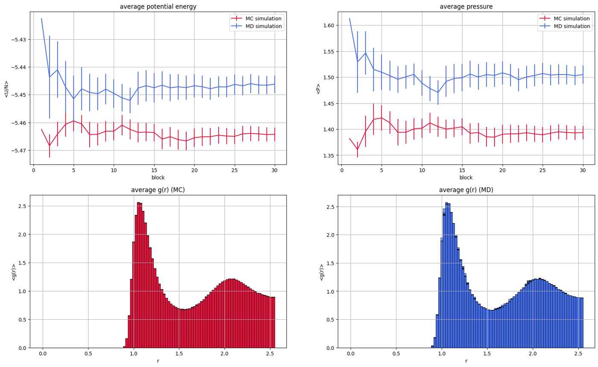
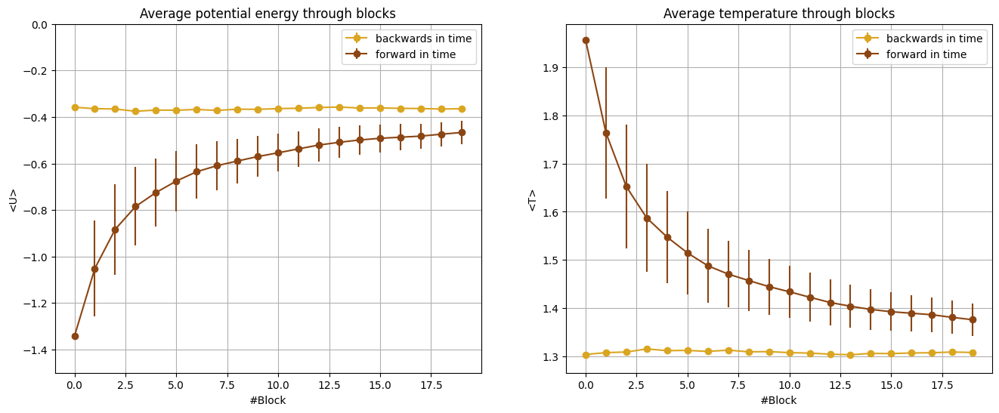
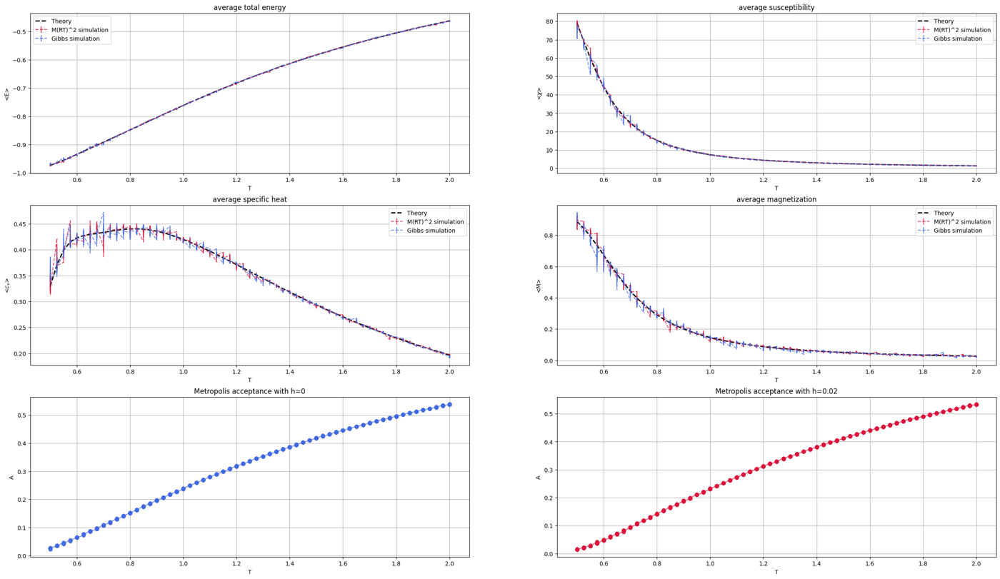

# Statistical mechanics simulations

Molecular dynamics and Monte Carlo simulations of classical many-body systems in C++: a Lennard-Jones fluid (argon) in the microcanonical ensemble, the Ising model in 1D and 2D, and a comparison between Monte Carlo and molecular dynamics. Every folder contains the code and a notebook with the theory, the results and the plots.

The simulator was developed starting from the framework of the Numerical Simulation Laboratory course (prof. D.E. Galli, University of Milan), which provided the base `NSL_SIMULATOR` code and the random number generator. Each folder has its own copy of the simulator because it contains the changes made for that part (initial conditions, time inversion, tail corrections, g(r), ...). The 2D Ising notebook (`04_ising_model_2d`, in Python) comes from the Statistical Physics course (prof. S. Zapperi, University of Milan), and its theory parts are taken from the course material.



## Contents

**01_molecular_dynamics** - Lennard-Jones gas integrated with the Verlet algorithm. Starting from particles with the same speed in opposite directions, the velocities relax to the Maxwell-Boltzmann distribution. Then a test of time reversibility: the simulation is restarted after swapping the last two configurations, and the system does not go back to its initial state because of the accumulation of numerical errors.



**02_ising_model** - 1D Ising model sampled with both the Metropolis and the Gibbs algorithms: internal energy, specific heat, susceptibility and magnetization as a function of the temperature, compared with the exact solution.



**03_mc_vs_md** - tail corrections for the cutoff of the potential, autocorrelation functions and choice of the block length for the data blocking, implementation of the radial distribution function g(r), and comparison between a Monte Carlo NVT and a molecular dynamics NVE simulation of liquid argon (potential energy, pressure and g(r), plot at the top).

**04_ising_model_2d** - 2D Ising model with Metropolis and with the Wolff cluster algorithm: equilibration, magnetization, susceptibility and specific heat across the phase transition, labelling of the spin clusters and their size distribution, which becomes a power law at T_c.

## Usage

The simulator needs [Armadillo](https://arma.sourceforge.net/). For each part:

```
cd 01_molecular_dynamics/4.1/NSL_SIMULATOR/SOURCE
make
./simulator.exe
```

The parameters of the simulation are in `INPUT/input.dat` (examples for solid, liquid, gas and Ising in `INPUT/INPUT_EXAMPLES`), and the results are written in `OUTPUT`. The notebooks read the data from the `OUTPUT` folders. The largest data files of the MC vs MD comparison (instantaneous energies, about 24 MB each) are not included, they are produced by running the simulation.

The 2D Ising notebook needs numpy, matplotlib and seaborn. The efficient simulations (Metropolis sweeps and Wolff algorithm) use the `IsingModel` class from the computer exercises of J.P. Sethna's book *Statistical Mechanics: Entropy, Order Parameters, and Complexity* ([Ising exercise](http://pages.physics.cornell.edu/~myers/teaching/ComputationalMethods/ComputerExercises/Ising/Ising.html)), which is not included: to run those cells, save it as `ising_sethna.py` next to the notebook.
